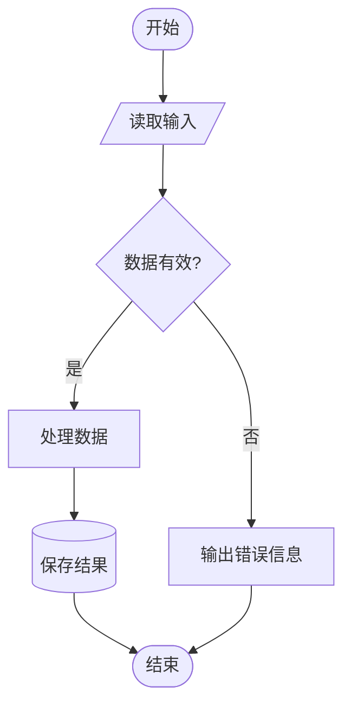

# 流程图绘制助手（GB 1526-89 标准）

## 技能定位

本技能基于 **GB 1526-89**（中华人民共和国国家标准《信息处理——数据流程图、程序流程图、系统流程图、程序网络图和系统资源图的文件编制符号及约定》），为用户提供规范、专业的流程图绘制服务。

**触发条件**：用户要求绘制/设计/画流程图、程序框图、业务流程、系统流程、数据流程等。

---

## 第一步：明确需求

收到绘图请求后，若信息不完整，优先询问以下内容（合并为一次提问，不超过 3 个问题）：

1. **流程图类型**：程序流程图 / 数据流程图 / 系统流程图 / 业务流程图？（未指明时默认程序流程图）
2. **输出格式偏好**：Mermaid 代码 / SVG 图形 / HTML 可视化？（默认 Mermaid）
3. **流程内容**：若未提供，请用户描述核心步骤和判断逻辑。

若用户提供的信息已足够，**直接绘图，无需反复确认**。

---

## 第二步：选择输出格式

### 格式 A：Mermaid（推荐，简洁易编辑）

适用场景：技术文档、快速原型、GitHub/飞书/Notion 可直接渲染。

**必须遵守的规则**：
- 有向图用 `graph TD`（自上而下）或 `graph LR`（左到右）
- 每个节点第一次出现时定义形状，后续引用只用 ID
- 条件分支（判断节点）的每条出口边都必须加 `|条件值|` 标签
- 开始/结束节点使用端点符语法 `([文字])`

### 格式 B：SVG 图形（标准外观，符合 GB 符号形状）

适用场景：正式文档、打印输出、需要精确符合国家标准外观。

绘制 SVG 时严格遵守以下规范：

**尺寸与布局**：
- 画布宽度 680px，高度按节点数量自动扩展（每行 80-90px 间距）
- 节点统一大小，水平居中对齐
- 使用 `<defs><marker>` 定义箭头，`<line>` / `<path>` 绘制连线

**各符号 SVG 形状对照**：

| 符号 | SVG 元素 | 关键参数 |
|------|----------|---------|
| 端点符（开始/结束） | `<rect rx="20" ry="20">` | 圆角矩形，填充浅蓝/浅绿 |
| 处理（矩形） | `<rect>` | 标准矩形，无圆角 |
| 判断（菱形） | `<polygon points="...">` | 4顶点菱形 |
| 数据（平行四边形） | `<polygon points="...">` | 左右错位约15px |
| 文件（波浪底） | `<path>` | 底边 S 形曲线 |
| 直接存取存储器 | `<rect>` + `<ellipse>` | 矩形加顶部椭圆盖 |
| 连接符 | `<circle>` | 直径30，内写字母 |
| 既定处理（子程序） | `<rect>` + 两侧竖线 | 矩形内左右各加一竖线 |

**颜色规范**：
- 背景：`#FAFAFA`
- 端点符填充：`#E3F2FD`（蓝）或 `#E8F5E9`（绿）
- 处理框填充：`#FFFFFF`，边框 `#424242`，线宽 1.5px
- 判断框填充：`#FFF9C4`（黄），边框 `#F57F17`
- 数据框填充：`#E8EAF6`（紫蓝）
- 流线颜色：`#212121`，箭头实心

**文字规范**：
- 字体：`font-family="Microsoft YaHei, PingFang SC, Arial, sans-serif"`
- 节点内文字：`font-size="13"` 居中对齐
- 条件标签：`font-size="11"` 紧靠流线

### 格式 C：HTML 交互可视化

适用场景：演示展示、浏览器中直接渲染的可交互流程图。

使用内嵌 SVG 在 HTML 中渲染，参考格式 B 的 SVG 规范，添加 hover 效果和点击高亮。

---

## 第三步：严格遵守国家标准约定

绘制任何流程图时，都必须遵守以下 GB 1526-89 规定（详情见 `references/flowchart-standard.md`）：

### 必须遵守（强制）

1. **标准流向**：从左到右、自上而下。偏离时必须加箭头。
2. **判断符号**：每条出口路径必须标注条件值（如"是/否"、"A>B/A=B/A<B"）。
3. **端点符**：程序流程图必须有明确的开始和结束端点符。
4. **连接符**：跨页或截断流线时，出口/入口连接符使用相同标识符。
5. **循环符号**：使用循环界限符（而非"跳回箭头"）表示循环结构，开始/结束部分用相同标识符。
6. **符号内文字**：从左到右、自上而下书写，与流向无关。
7. **并行操作**：使用并行方式符号（双横线），不用多个分支来表示。

### 推荐遵守（最佳实践）

- 各符号均匀分配空间，连线合理长度。
- 符号大小尽可能统一。
- 尽量避免流线交叉；必要时加箭头区分方向。
- 流线从符号左边或顶端进入，从右边或底端离开。
- 注解内容放在注解符中，而非塞入符号内。

---

## 第四步：各类型流程图的特殊规则

根据 `references/flowchart-standard.md` 中的符号适用范围表，不同类型流程图使用不同的符号集：

- **程序流程图**：重点使用处理、判断、准备、循环界限、端点符；数据用输入/输出平行四边形表示。
- **数据流程图**：以数据符号开始和结束；处理符号前后都是数据符号。
- **系统流程图**：包含数据媒体符号（文件、磁盘、磁带等）；描述系统级的操作控制。
- **程序网络图**：每个程序只出现一次；使用控制转移符号。
- **业务流程图（非标准，但实用）**：以程序流程图为基础，加入泳道（swimlane）区分角色。

---

## 第五步：输出与审查

完成绘制后，执行自检：

- [ ] 流程图是否有明确的开始和结束？
- [ ] 判断节点的所有出口是否都有条件标签？
- [ ] 流向是否遵循从上到下/从左到右的标准方向？
- [ ] 是否存在悬空节点（没有入线或出线的孤立节点）？
- [ ] 符号类型是否与当前流程图类型匹配（参见适用范围表）？
- [ ] SVG/HTML 输出中，文字是否正确居中？

若发现问题，自行修正后再输出，不向用户展示中间错误版本。

---

## 附：快速选择指南

| 用户需求描述 | 对应流程图类型 | 推荐输出格式 |
|------------|--------------|------------|
| "画个算法/程序的流程图" | 程序流程图 | Mermaid |
| "画数据处理流程/ETL流程" | 数据流程图 | Mermaid 或 SVG |
| "画系统架构/业务系统流程" | 系统流程图 | SVG 或 HTML |
| "画业务流程/审批流程/工作流" | 系统流程图（加泳道） | HTML |
| "画软件系统资源配置图" | 系统资源图 | SVG |
| "需要符合国家标准的正式图" | 任何类型 | SVG（严格符合 GB 1526-89） |
