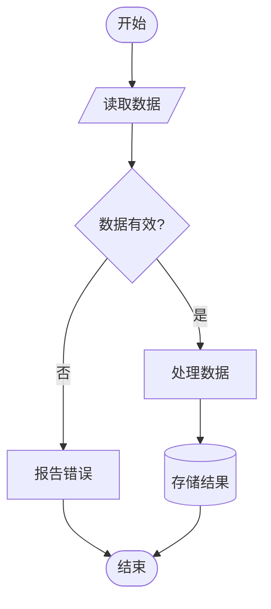

# 流程图符号国家标准参考手册
## 依据：GB 1526-89（等同采用 ISO 5807-1985）

---

## 一、流程图类型

| 类型 | 描述 |
|------|------|
| 数据流程图 | 表示数据通路、处理阶段和所用数据媒体 |
| 程序流程图 | 表示程序中的操作顺序 |
| 系统流程图 | 表示系统的操作控制和数据流 |
| 程序网络图 | 表示程序激活路径和程序与数据的相互作用 |
| 系统资源图 | 表示数据单元和处理单元的配置 |

---

## 二、数据符号（Data Symbols）

### 2.1 基本数据符号

| 符号名称 | 形状描述 | 含义 |
|----------|----------|------|
| **数据（Data）** | 平行四边形 | 表示数据，未规定媒体类型 |
| **存储数据（Stored Data）** | 左侧有弧形切口的矩形（类似文件卷） | 以适合处理的形式存储的数据，未规定媒体 |

### 2.2 特定数据符号

| 符号名称 | 形状描述 | 含义 | 适用图类型 |
|----------|----------|------|------------|
| **内存储器（Internal Storage）** | 矩形内有两条横线（上下各一） | 媒体为内存储器的数据 | 系统流程图、程序流程图 |
| **顺序存取存储器（Sequential Access）** | 圆角矩形（类似磁带卷轴） | 只能顺序存取（磁带、卡式磁带等） | 数据流程图、系统流程图 |
| **直接存取存储器（Direct Access）** | 圆柱体 | 可直接存取（磁盘、软磁盘等） | 数据流程图、系统流程图、系统资源图 |
| **文件（Document）** | 波浪形底边的矩形 | 人可阅读的数据（打印输出、OCR文件等） | 数据流程图、系统流程图 |
| **人工输入（Manual Input）** | 梯形（上边倾斜） | 手工输入数据（键盘、开关、光笔等） | 数据流程图、系统流程图 |
| **卡片（Card）** | 矩形（右上角被切去一角） | 媒体为卡片（穿孔卡、磁卡等） | 数据流程图、系统流程图 |
| **穿孔带（Punched Tape）** | 波浪形两端的长条形 | 媒体为纸带 | 数据流程图、系统流程图 |
| **显示（Display）** | 显示屏形状（右侧为直边，左侧弧形） | 视频屏幕、联机指示器等显示媒体 | 数据流程图、系统流程图 |

---

## 三、处理符号（Process Symbols）

### 3.1 基本处理符号

| 符号名称 | 形状描述 | 含义 |
|----------|----------|------|
| **处理（Process）** | 矩形 | 各种处理功能（执行操作、改变值/形式/位置，或确定流向） |

### 3.2 特定处理符号

| 符号名称 | 形状描述 | 含义 | 适用图类型 |
|----------|----------|------|------------|
| **既定处理（Predefined Process）** | 矩形内左右两侧各有一条竖线 | 已命名处理（子例程、模块） | 程序流程图、系统流程图 |
| **人工操作（Manual Operation）** | 梯形（下边倾斜，上宽下窄） | 人工执行的处理 | 系统流程图 |
| **准备（Preparation）** | 六边形（左右各切一角的矩形） | 修改后续指令（如设置开关、初始化例行程序） | 程序流程图 |
| **判断（Decision）** | 菱形 | 判断或开关功能，一个入口，若干出口 | 程序流程图、系统流程图 |
| **并行方式（Parallel Mode）** | 双横线（两条平行水平线之间含处理内容） | 同步进行两个或两个以上并行操作 | 程序流程图、程序网络图 |
| **循环界限（Loop Limit）** | 六边形（上端尖角或下端尖角），分为开始和结束两部分 | 循环的开始和结束，需使用同一标识符 | 程序流程图 |

---

## 四、流线符号（Line Symbols）

### 4.1 基本流线符号

| 符号名称 | 形状描述 | 含义 |
|----------|----------|------|
| **流线（Flow Line）** | 带箭头的线段 | 数据流或控制流 |

### 4.2 特定流线符号

| 符号名称 | 形状描述 | 含义 |
|----------|----------|------|
| **控制转移（Communication Link）** | 带双箭头的波浪线或锯齿线 | 从一个处理到另一个处理的直接控制转移 |
| **通信连接（Communication Link）** | 带箭头的闪电形曲线 | 通过远程通信线路进行的数据传送 |
| **虚线（Dashed Line）** | 虚线（- - - -） | 表示符号间的选择关系，或标出被注解的区域 |

---

## 五、特殊符号（Special Symbols）

| 符号名称 | 形状描述 | 含义 |
|----------|----------|------|
| **连接符（Connector）** | 小圆圈 | 转向流程图它处或从它处转入，用于截断流线 |
| **端点符（Terminator）** | 圆角矩形（跑道形） | 转向外部环境或从外部转入（程序起始/结束） |
| **注解符（Annotation）** | 方括号形（一侧开口）连接虚线 | 标识注解内容，虚线连接到相关符号上 |
| **省略符（Omission）** | 三个点（…） | 表示对一个或一组符号的省略（仅用在流线中） |

---

## 六、符号适用范围汇总

| 符号名称 | 数据流程图 | 程序流程图 | 系统流程图 | 程序网络图 | 系统资源图 |
|----------|:---:|:---:|:---:|:---:|:---:|
| 数据 | ● | | ● | ● | |
| 存储数据 | ● | | ● | ● | |
| 内存储器 | | ● | ● | | |
| 顺序存取存储器 | ● | | ● | | |
| 直接存取存储器 | ● | | ● | | ● |
| 文件 | ● | | ● | | |
| 人工输入 | ● | | ● | | |
| 卡片 | ● | | ● | | |
| 穿孔带 | ● | | ● | | |
| 显示 | ● | | ● | | |
| 处理 | ● | ● | ● | ● | ● |
| 既定处理 | | ● | ● | | |
| 人工操作 | | | ● | | |
| 准备 | | ● | | | |
| 判断 | | ● | ● | | |
| 并行方式 | | ● | | ● | |
| 循环界限 | | ● | | | |
| 流线 | ● | ● | ● | ● | ● |
| 控制转移 | | | | ● | |
| 通信连接 | ● | | ● | | |
| 虚线 | ● | ● | ● | ● | ● |
| 连接符 | ● | ● | ● | ● | ● |
| 端点符 | | ● | | | |
| 注解符 | ● | ● | ● | ● | ● |
| 省略符 | ● | ● | ● | ● | ● |

---

## 七、绘图约定（GB 1526-89 第11章）

### 7.1 符号约定

1. **布局**：各符号均匀分配空间，连线保持合理长度，尽量少用长线。
2. **形状**：不改变角度和其他影响符号形状的因素，尽可能统一各符号大小。
3. **方向**：符号描绘方向任意，推荐水平方向。
4. **符号内文字**：按从左到右、自上而下书写，与流向无关；文字过多时使用注解符。
5. **符号标识符**：写在符号**左上角**，便于其他文件引用。
6. **符号描述符**：写在符号**右上角**，用于交叉引用或进一步说明功能。
7. **详细表示**：在符号内靠近某端画一横线，表示该符号在文件集其他地方有更详细表示。

### 7.2 连接约定

1. **标准流向**：从**左到右**、**自上而下**。
2. **箭头使用**：流程不遵循标准流向时**必须**加箭头；交叉点处可随时加箭头增强清晰度。
3. **流线交叉**：尽量避免；若出现交叉，交叉流线之间无逻辑关系。
4. **流线汇集**：多根进入线可汇集为一根输出线，各连接点应相互错开，必要时加箭头。
5. **互连方向**：流线应从符号的**左边或顶端进入**、从**右边或底端离开**，对准符号中心。

### 7.3 连接符约定

- 出口连接符（离开处）与入口连接符（到达处）使用**相同标识符**。
- 换页引用可用与连接符相连的注解表示（如"到22页"、"接14页"）。

### 7.4 多出口约定

两种表示方式：
- 直接从该符号引出多条流线通向其他符号；
- 从该符号引出一条流线，再分支成多条。

每个出口都应标有**适当的条件值**，以反映其逻辑路径（如 A>B / A=B / A<B）。

### 7.5 重复表示

- 用**多个符号重叠**的形式表示多个同类符号（如多份报告副本、多张卡片）。
- 重叠为有序集时，顺序按从前往后理解。

---

## 八、Mermaid 语法与符号对应（实用速查）

> Mermaid flowchart 是当前主流的文本化流程图语法，以下为 GB 标准符号与 Mermaid 语法的对应关系。

```
graph TD / graph LR  （TD=自上而下，LR=从左到右）
```

| GB 符号 | Mermaid 语法示例 | 说明 |
|---------|-----------------|------|
| 端点符（开始/结束） | `A([开始])` 或 `A([结束])` | 圆角矩形/椭圆 |
| 处理 | `B[处理名称]` | 矩形 |
| 判断 | `C{条件?}` | 菱形 |
| 数据（输入/输出） | `D[/数据/]` | 平行四边形 |
| 既定处理（子程序） | `E[[子例程名]]` | 双竖线矩形 |
| 直接存取存储器 | `F[(数据库)]` | 圆柱形 |
| 连接符 | 使用节点标签跳转 | 用相同节点名连接 |
| 注解 | 注释行 `%% 注解内容` | Mermaid 注释 |
| 流线（标准） | `A --> B` | 带箭头实线 |
| 流线（带标签） | `A -->|是| B` | 带条件标签 |
| 虚线 | `A -.-> B` | 虚线箭头 |
| 粗线 | `A ==> B` | 粗箭头 |

**Mermaid 完整示例：**


---

## 九、SVG 手工绘制参考尺寸

> 当需要使用 SVG 绘制符合 GB 标准的流程图时，参考以下标准尺寸。

| 符号 | 推荐宽×高 | 形状要点 |
|------|----------|---------|
| 处理（矩形） | 120×50 | 标准矩形 |
| 判断（菱形） | 100×60 | 对角线等分 |
| 端点符 | 120×40 | rx/ry = 20 的圆角矩形 |
| 数据（平行四边形） | 120×50 | 偏移量约15px |
| 文件（波浪底） | 120×55 | 底边为 S 形曲线 |
| 直接存取存储器（圆柱） | 100×60 | 顶底各一个椭圆 |
| 连接符（圆圈） | 直径30 | 内写标识符 |
| 流线 | — | 1.5px 线宽，箭头末端 |

字体推荐：
- 中文：微软雅黑 / 宋体，字号 12-14px
- 英文：Arial / Helvetica
- 行距/间距：符号内文字居中对齐
